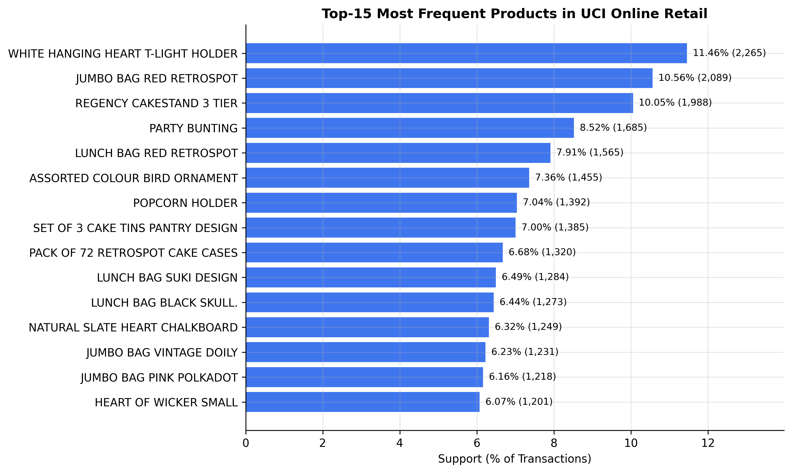

# Chương 3 — Ứng dụng 1: Phân tích Giỏ hàng (Market Basket Analysis)

> **Lưu ý về tính độc lập thuật toán:** Toàn bộ tập phổ biến đóng (Closed Frequent Itemsets) và luật kết hợp (Association Rules) trong ứng dụng này được khai thác trực tiếp bằng cài đặt từ đầu của nhóm (`CharmMining.jl` — phiên bản **Optimized CHARM** `mine_file_bit` cùng module sinh luật dựa trên bao đóng `src/rules.jl`), **không sử dụng bất kỳ thư viện FIM bên ngoài nào** (`mlxtend`, `efficient-apriori`, hay SPMF).

---

## 1. Lựa chọn dữ liệu & Chiến lược biến đổi sang giao dịch phù hợp với CHARM

### 1.1. Tập dữ liệu thực tế: UCI Online Retail
Nhóm lựa chọn tập dữ liệu thương mại điện tử thực tế **UCI Online Retail** (nguồn: [UCI Machine Learning Repository #352](https://archive.ics.uci.edu/dataset/352/online+retail)), ghi nhận toàn bộ giao dịch bán lẻ trực tuyến của một doanh nghiệp quà tặng và đồ gia dụng tại Vương quốc Anh trong giai đoạn từ **01/12/2010 đến 09/12/2011**, gồm **541.909 dòng hóa đơn** trên **25.900 mã hóa đơn (`InvoiceNo`)** và **4.070 mã sản phẩm (`StockCode`)**.

So với tệp benchmark `retail.txt` (chỉ chứa mã số ẩn danh không có tên sản phẩm), **UCI Online Retail** chứa đầy đủ thông tin nghiệp vụ (`InvoiceNo`, `StockCode`, `Description`, `Quantity`, `UnitPrice`, `Country`), cho phép kiểm chứng quy trình làm sạch dữ liệu thực tế và diễn giải sâu ý nghĩa kinh doanh của từng luật kết hợp.

### 1.2. Tại sao cách biến đổi dữ liệu này phù hợp với thuật toán CHARM?
Để chuyển đổi bảng hóa đơn thô sang cơ sở dữ liệu giao dịch chuẩn SPMF (`.txt`), nhóm thiết kế quy trình trích xuất theo **cấp độ hóa đơn (`InvoiceNo`)**: mỗi hóa đơn hợp lệ trở thành một giao dịch chứa tập các mã sản phẩm (`StockCode`) duy nhất đã được ánh xạ sang mã nguyên liên tục `1..M`.

Quyết định này khai thác đúng điểm mạnh cốt lõi của **CHARM (Closed Frequent Itemset Mining)**:
1. **Giảm bùng nổ tổ hợp trên các bộ sản phẩm đồng bộ:** Dữ liệu bán lẻ trực tuyến có mật độ rất thưa (**0.691%**), nhưng chứa nhiều nhóm sản phẩm được mua trọn bộ (như bộ nhãn thảo mộc 5 món, bộ đĩa trà Regency 3 màu, bộ đồ chơi Poppy's Playhouse 3 phòng). Với thuật toán khai thác mọi tập phổ biến thông thường (Apriori, FP-Growth), một bộ $k$ sản phẩm luôn xuất hiện cùng nhau sinh ra $2^k - 1$ tập con có **cùng độ hỗ trợ (support)**, gây dư thừa nặng nề. **CHARM** chỉ lưu giữ **tập phổ biến đóng** (Closed Frequent Itemset), nén gọn không gian kết quả mà không mất bất kỳ thông tin nào.
2. **Tối ưu phép giao dọc trên `BitVector` (`FastBitTidset`):** Sau khi làm sạch, số giao dịch là $|D| = 19.773$ ($\lceil 19.773 / 64 \rceil = 309$ từ 64-bit, tương đương chỉ ~2.47 KB mỗi `Tidset`). Phép giao tập giao dịch $T(X) \cap T(Y)$ bằng `@inbounds @simd` trên bản Optimized CHARM đạt tốc độ dưới **75 ms** tại ngưỡng `minsup = 1.0%`.
3. **Loại bỏ nhiễu phi hàng hóa trước khi khai thác:** Các mã phí vận chuyển (`POST`, `DOT`), điều chỉnh thủ công (`M`, `ADJUST`), phí ngân hàng (`BANK CHARGES`) nếu không loại bỏ sẽ xuất hiện trong rất nhiều hóa đơn và tạo ra các luật tầm thường (ví dụ: `POSTAGE => Sản phẩm X`) làm sai lệch phân tích hành vi mua sắm.

### 1.3. Quy trình làm sạch và thống kê dữ liệu
Mã tiền xử lý được cài đặt tái lập hoàn toàn trong `applications/market_basket/prepare_data.py` và tích hợp trong notebook `notebooks/app1_market_basket.ipynb`:

| Bước xử lý / Chỉ số | Số lượng | Ghi chú |
|---|---:|---|
| Số dòng hóa đơn gốc (Raw rows) | 541.909 | 25.900 hóa đơn, 4.070 mã `StockCode` |
| Loại bỏ thiếu `InvoiceNo` / `StockCode` / `Description` | −1.454 | Thiếu định danh sản phẩm |
| Loại bỏ đơn hàng bị hủy (`InvoiceNo` bắt đầu bằng `C`) | −9.288 | Giao dịch hoàn trả / hủy đơn |
| Loại bỏ `Quantity <= 0` hoặc `UnitPrice <= 0` | −1.063 | Dữ liệu điều chỉnh kho / hàng hỏng |
| Loại bỏ mã phí dịch vụ (`POST`, `DOT`, `M`, `BANK CHARGES`, ...) | −2.536 | Không phải hàng hóa thương mại |
| **Số dòng sạch còn lại (Clean rows)** | **527.568** | **97.35%** dữ liệu gốc |
| **Số giao dịch / hóa đơn ($|D|$)** | **19.773** | Trong đó **18.267** hóa đơn có $\ge 2$ sản phẩm |
| **Số sản phẩm duy nhất ($|I|$)** | **3.787** | Chuẩn hóa tên đại diện theo `StockCode` |
| Kích thước giỏ hàng (Trung bình / Trung vị / Tối đa) | 26.15 / 15 / 1.105 | Phân bố lệch phải do đơn sỉ B2B |
| Mật độ ma trận giao dịch | 0.691% | Dữ liệu bán lẻ thưa (sparse) điển hình |

---

## 2. Cơ sở toán học: Sinh luật kết hợp chính xác từ Tập phổ biến đóng

Thuật toán CHARM trả về tập các **tập phổ biến đóng** $\mathcal{C} = \{ (C, \text{supp}(C)) \mid C = c(C),\; \text{supp}(C) \ge \text{minsup} \}$. Với một tập con bất kỳ $X \subset C$ ($X$ có thể **không** tự đóng), theo tính chất bao đóng Galois (Pasquier et al., 1999; Zaki & Hsiao, 2002), độ hỗ trợ chính xác của $X$ bằng độ hỗ trợ của bao đóng nhỏ nhất chứa $X$:

$$\text{supp}(X) = \text{supp}(c(X)) = \max \{ \text{supp}(C') \mid C' \in \mathcal{C},\; X \subseteq C' \}$$

Trong `src/rules.jl`, nhóm cài đặt cấu trúc chỉ mục **`ClosureSupportIndex`** sắp xếp $\mathcal{C}$ theo thứ tự giảm dần của `support` kèm danh sách đảo ngược theo từng item, cho phép tra cứu chính xác $\text{supp}(A)$ và $\text{supp}(B)$ bằng cơ chế dừng sớm (early stopping) và lưu đệm (memoization).

Từ mỗi tập phổ biến đóng $C \in \mathcal{C}$ ($|C| \ge 2$), mọi phân hoạch $A \Rightarrow B$ với $A \cup B = C$, $A \cap B = \emptyset$, $A \ne \emptyset$, $B \ne \emptyset$ được đánh giá theo các độ đo:

- **Độ hỗ trợ (Support):**
  $$\text{Support}(A \Rightarrow B) = \frac{\text{supp}(A \cup B)}{|D|}$$
- **Độ tin cậy (Confidence):**
  $$\text{Confidence}(A \Rightarrow B) = \frac{\text{supp}(A \cup B)}{\text{supp}(A)}$$
- **Hệ số nâng (Lift):**
  $$\text{Lift}(A \Rightarrow B) = \frac{\text{Confidence}(A \Rightarrow B)}{\text{Support}(B)} = \frac{\text{supp}(A \cup B) \cdot |D|}{\text{supp}(A) \cdot \text{supp}(B)}$$
- **Đòn bẩy (Leverage):**
  $$\text{Leverage}(A \Rightarrow B) = \text{Support}(A \cup B) - \text{Support}(A) \cdot \text{Support}(B)$$

Ý nghĩa của **Lift**: $\text{Lift} > 1$ cho thấy $A$ và $B$ có tương quan dương (xuất hiện cùng nhau thường xuyên hơn ngẫu nhiên); $\text{Lift} = 1$ nghĩa là độc lập thống kê; $\text{Lift} < 1$ là tương quan âm (thay thế nhau).

---

## 3. Kết quả khai thác & Phân tích độ nhạy theo `minsup`

Chạy script `julia --project=. applications/market_basket/run_mba.jl` trên tập 19.773 giao dịch cho kết quả độ nhạy qua 7 ngưỡng `minsup` từ 5.0% xuống 0.8%:

| `minsup` (%) | `minsup` (số HĐ) | Số tập đóng ($\|\mathcal{C}\|$) | Độ dài tối đa | Số luật (`conf >= 50%`) | Thời gian Optimized CHARM (ms) |
|---:|---:|---:|---:|---:|---:|
| 5.00% | 989 | 36 | 1 | 0 | 0.15 |
| 3.00% | 594 | 143 | 2 | 14 | 1.58 |
| 2.50% | 495 | 234 | 3 | 40 | 3.03 |
| 2.00% | 396 | 395 | 3 | 61 | 10.64 |
| 1.50% | 297 | 763 | 4 | 215 | 23.74 |
| **1.00%** | **198** | **2.026** | **5** | **962** | **71.26** |
| 0.80% | 159 | 3.804 | 5 | 2.882 | 114.82 |

**Lựa chọn điểm vận hành chính (`minsup = 1.0%`, `minconf = 50%`, `minlift >= 1.0`):**
- Tại `minsup >= 2.0%`, chỉ tìm được ít luật (61 luật) và bỏ sót các nhóm sản phẩm theo mùa/chuyên biệt có tần suất ~1% (tương đương ~200 hóa đơn/năm).
- Tại `minsup = 1.0%` (tối thiểu 198 hóa đơn), Optimized CHARM chỉ mất **71.26 ms** để tìm **2.026 tập phổ biến đóng** (trong đó **1.197** tập có kích thước $\ge 2$, tối đa 5 sản phẩm) và sinh ra **962 luật kết hợp** đạt `confidence >= 50%` và `lift >= 1.0` — đủ giàu thông tin mà vẫn đảm bảo ý nghĩa thống kê vững chắc (~200+ đơn hàng mỗi luật).

---

## 4. Top-10 Luật kết hợp theo Lift & Phân tích đa nhóm sản phẩm

### 4.1. Top-10 Luật kết hợp có Lift cao nhất (đã khử cặp đối xứng)
Với các cặp luật đối xứng $(A \Rightarrow B)$ và $(B \Rightarrow A)$ có cùng giá trị Lift, bảng dưới đây giữ lại chiều có **Confidence cao hơn** để tối đa hóa lượng thông tin trong 10 vị trí đầu tiên (toàn bộ cả bản chưa khử đối xứng và đã khử đều được lưu tại `results/app1/top10_rules_lift_raw.csv` và `results/app1/top10_rules_lift_dedup.csv`):

| Hạng | Vế trái (Antecedent) | Vế phải (Consequent) | Support (%) | Số HĐ | Confidence (%) | **Lift** | Leverage |
|---:|---|---|---:|---:|---:|---:|---:|
| 1 | `HERB MARKER THYME` | `HERB MARKER ROSEMARY + HERB MARKER PARSLEY` | 1.03% | 203 | 85.65% | **78.77** | 0.0101 |
| 2 | `HERB MARKER THYME + HERB MARKER PARSLEY` | `HERB MARKER ROSEMARY` | 1.03% | 203 | 95.31% | **78.52** | 0.0101 |
| 3 | `HERB MARKER ROSEMARY` | `HERB MARKER THYME + HERB MARKER BASIL` | 1.01% | 200 | 83.33% | **78.46** | 0.0100 |
| 4 | `HERB MARKER ROSEMARY + HERB MARKER BASIL` | `HERB MARKER THYME` | 1.01% | 200 | 93.46% | **77.97** | 0.0100 |
| 5 | `HERB MARKER THYME` | `HERB MARKER ROSEMARY` | 1.12% | 221 | 93.25% | **76.83** | 0.0110 |
| 6 | `HERB MARKER THYME + HERB MARKER ROSEMARY` | `HERB MARKER PARSLEY` | 1.03% | 203 | 91.86% | **76.31** | 0.0101 |
| 7 | `HERB MARKER THYME` | `HERB MARKER PARSLEY` | 1.08% | 213 | 89.87% | **74.67** | 0.0106 |
| 8 | `HERB MARKER PARSLEY` | `HERB MARKER ROSEMARY` | 1.09% | 215 | 90.34% | **74.43** | 0.0107 |
| 9 | `HERB MARKER THYME + HERB MARKER ROSEMARY` | `HERB MARKER BASIL` | 1.01% | 200 | 90.50% | **73.94** | 0.0100 |
| 10 | `HERB MARKER PARSLEY` | `HERB MARKER MINT` | 1.07% | 212 | 89.08% | **73.39** | 0.0106 |

### 4.2. Mở rộng phân tích: Các cụm sản phẩm tiêu biểu ngoài nhóm Herb Marker
Một phát hiện quan trọng khi xếp hạng thuần theo Lift là toàn bộ Top-10 đều tập trung vào bộ sưu tập **Herb Marker** (Lift 73–79). Để có bức tranh kinh doanh toàn diện hơn cho cửa hàng, nhóm phân tích thêm các luật có Lift cao nhất thuộc **các danh mục sản phẩm khác nhau** trong tập 962 luật (`results/app1/all_rules.csv`):

| Danh mục / Cụm sản phẩm | Luật tiêu biểu | Support (%) | Confidence (%) | **Lift** |
|---|---|---:|---:|---:|
| **Bộ đĩa & tách trà Regency** | `REGENCY TEA PLATE PINK` $\Rightarrow$ `REGENCY TEA PLATE ROSES + GREEN` | 1.29% (255) | 83.6% | **51.82** |
| **Bổ trợ bàn trà Regency** | `REGENCY SUGAR BOWL GREEN` $\Rightarrow$ `REGENCY MILK JUG PINK` | 1.23% (243) | 75.5% | **45.36** |
| **Trang trí Giáng sinh gỗ** | `SET OF 3 WOODEN TREE DECORATIONS` $\Rightarrow$ `SET OF 3 WOODEN STOCKING DECORATION` | 1.11% (219) | 74.7% | **46.33** |
| **Nhà búp bê Poppy's Playhouse** | `POPPY'S PLAYHOUSE LIVINGROOM` $\Rightarrow$ `BEDROOM + KITCHEN` | 1.13% (224) | 68.3% | **43.14** |
| **Hũ mứt gia dụng** | `JAM JAR WITH GREEN LID` $\Rightarrow$ `JAM JAR WITH PINK LID` | 1.15% (228) | 74.3% | **42.94** |
| **Bộ dao nĩa trẻ em** | `CHILDRENS CUTLERY DOLLY GIRL` $\Rightarrow$ `CHILDRENS CUTLERY SPACEBOY` | 1.15% (228) | 76.2% | **40.97** |
| **Móc khóa gia đình** | `GARAGE KEY FOB` $\Rightarrow$ `KEY FOB , SHED` | 1.01% (200) | 71.9% | **38.24** |

---

## 5. Diễn giải ý nghĩa kinh doanh & Khuyến nghị thực tiễn

Từ các mẫu kết hợp thu được, nhóm rút ra **4 nhóm hành vi mua sắm cốt lõi** và các đề xuất hành động cụ thể cho doanh nghiệp bán lẻ:

### 5.1. Hành vi mua theo bộ sưu tập (Collection Bundling) — Nhóm *Herb Marker*, *Regency Tea Plate*, *Poppy's Playhouse*
- **Phát hiện:** Trong Top-10 luật, khách hàng mua `HERB MARKER THYME` có xác suất **93.25%** mua kèm `ROSEMARY` và **85.65%** mua đồng thời cả `ROSEMARY + PARSLEY` (Lift lên tới **78.77** — cao gấp ~79 lần so với xác suất ngẫu nhiên). Tương tự, khách mua `REGENCY TEA PLATE PINK` có xác suất **83.6%** mua kèm cả 2 màu `ROSES` và `GREEN` (Lift = **51.82**); khách mua phòng khách `POPPY'S PLAYHOUSE LIVINGROOM` có **68.3%** xác suất mua trọn bộ thêm phòng ngủ và nhà bếp (Lift = **43.14**).
- **Ý nghĩa kinh doanh:** Hiện tại cửa hàng đang bán rời từng SKU, buộc khách hàng phải tìm và thêm 3–5 sản phẩm riêng lẻ vào giỏ hàng, gây ma sát trải nghiệm (checkout friction) và dễ bỏ sót món.
- **Khuyến nghị:**
  1. **Đóng gói Combo trọn bộ (Product Bundling):** Tạo SKU combo *"Bộ 5 nhãn cắm thảo mộc làm vườn (Thyme – Rosemary – Parsley – Basil – Mint)"* và *"Bộ 3 đĩa trà Regency sắc màu"* với mức giảm 8–10% khi mua trọn bộ để tăng tỷ lệ chuyển đổi và giảm chi phí đóng gói.
  2. **Tiện ích "Thêm trọn bộ 1 cú nhấp" (One-Click Complete the Set):** Trên trang chi tiết của bất kỳ sản phẩm nào trong cụm (ví dụ `HERB MARKER THYME` hoặc `POPPY'S PLAYHOUSE LIVINGROOM`), hiển thị ngay nút thêm các mảnh ghép còn lại vào giỏ.

### 5.2. Bán chéo sản phẩm bổ trợ chức năng (True Complementary Cross-Selling)
- **Phát hiện:** Luật `REGENCY SUGAR BOWL GREEN => REGENCY MILK JUG PINK` (Confidence **75.5%**, Lift **45.36**) và `GARAGE KEY FOB => KEY FOB , SHED` (Confidence **71.9%**, Lift **38.24**) không phải là biến thể màu sắc của cùng một món hàng mà là **sản phẩm bổ trợ chức năng thực sự** (bình đường đi cùng bình sữa trên bàn trà; móc khóa nhà xe đi cùng móc khóa nhà kho).
- **Khuyến nghị:**
  1. **Gợi ý tại trang giỏ hàng (Cart-level Cross-sell):** Khi khách thêm bình đường Regency hoặc tách trà Regency vào giỏ, hệ thống gợi ý trực tiếp bình sữa Regency và kệ bánh 3 tầng (`REGENCY CAKESTAND 3 TIER`, sản phẩm bán chạy thứ 3 toàn hệ thống với support 10.05%).
  2. **Bố trí danh mục/kệ hàng theo ngữ cảnh sử dụng (Use-Case Merchandising):** Nhóm sản phẩm theo chủ đề *"Tiệc trà chiều kiểu Anh"* và *"Tổ chức không gian nhà & vườn"* thay vì chỉ phân loại cứng theo chất liệu.

### 5.3. Bán hàng theo mùa vụ & lễ hội (Seasonal Merchandising)
- **Phát hiện:** Các món đồ trang trí gỗ Giáng sinh như `SET OF 3 WOODEN TREE DECORATIONS` $\Rightarrow$ `SET OF 3 WOODEN STOCKING DECORATION` (Confidence **74.7%**, Lift **46.33**) và `WOODEN SLEIGH` $\Rightarrow$ `WOODEN STOCKING` (Confidence **67.9%**, Lift **42.08**) cho thấy xu hướng mua đồng bộ phụ kiện trang trí theo chủ đề mùa lễ.
- **Khuyến nghị:** Thiết kế chương trình khuyến mãi **"Mua 2 tặng 1 / Giảm 15% món thứ 3"** cho nhóm đồ trang trí gỗ trong giai đoạn cao điểm tháng 10–12 để tối đa hóa giá trị đơn hàng trung bình (Average Order Value — AOV).

### 5.4. Nhận diện phân khúc khách hàng sỉ B2B & Gia đình nhiều con
- **Phát hiện:** Luật `CHILDRENS CUTLERY DOLLY GIRL => CHILDRENS CUTLERY SPACEBOY` (Confidence **76.2%**, Lift **40.97**) cho thấy hai dòng sản phẩm tưởng chừng phân tách theo giới tính lại xuất hiện cùng nhau rất mạnh. Nguyên nhân xuất phát từ hai phân khúc đặc thù của tập UCI Online Retail: (i) hộ gia đình có cả bé trai và bé gái, và (ii) các cửa hàng quà tặng nhỏ (B2B wholesalers) nhập đồng thời cả hai mẫu để trưng bày kệ hàng.
- **Khuyến nghị:** Triển khai chính sách **chiết khấu theo cặp mẫu đối xứng (Assorted Pack Discount)** dành cho khách hàng B2B khi đặt cả hai phiên bản `Dolly Girl` và `Spaceboy`, đồng thời tối ưu dự báo tồn kho đồng bộ để tránh tình trạng hết hàng một mẫu kéo giảm doanh số mẫu còn lại.
