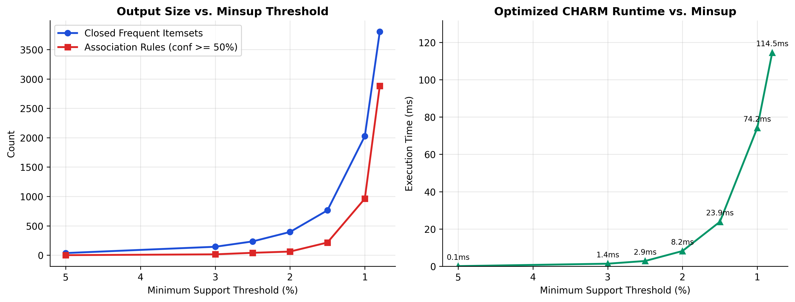
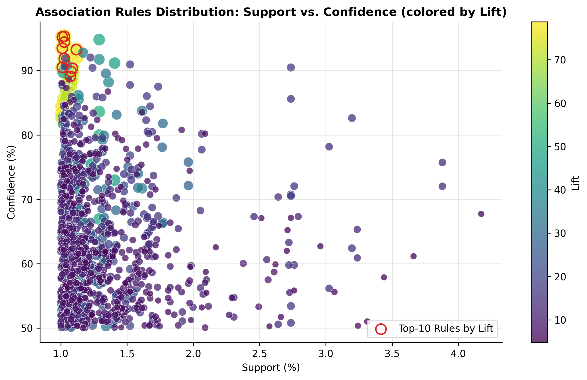
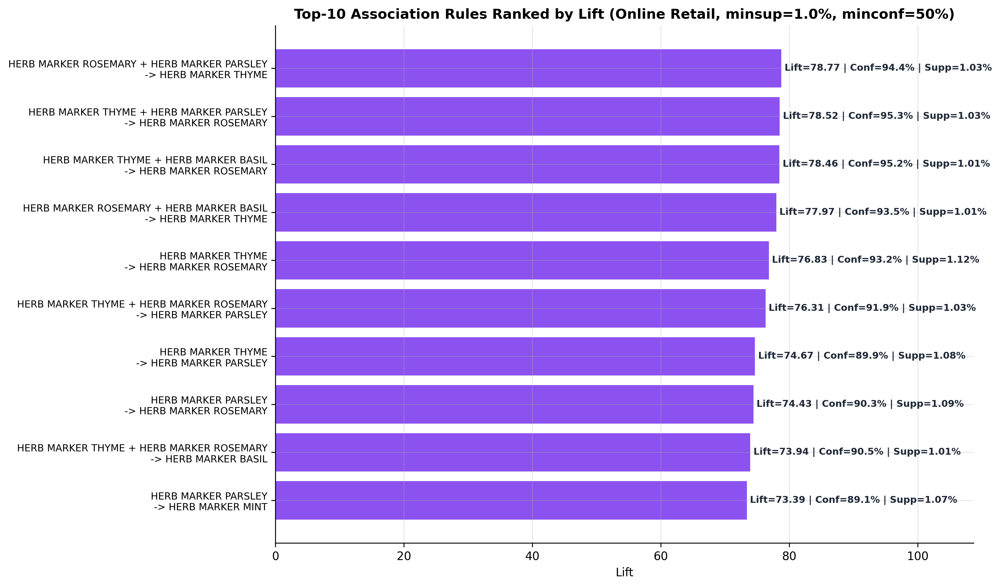

# Chương 3 — Ứng dụng 1: Phân tích Giỏ hàng (Market Basket Analysis)

> **Lưu ý về tính độc lập thuật toán:** Toàn bộ tập phổ biến đóng (Closed Frequent Itemsets) và luật kết hợp (Association Rules) trong ứng dụng này được khai thác trực tiếp bằng cài đặt từ đầu của nhóm (`CharmMining.jl` — phiên bản **Optimized CHARM** `mine_file_bit` cùng module sinh luật dựa trên bao đóng `src/rules.jl`), **không sử dụng bất kỳ thư viện FIM bên ngoài nào** (`mlxtend`, `efficient-apriori`, hay SPMF).

---

## 1. Lựa chọn dữ liệu & Chiến lược biến đổi sang giao dịch phù hợp với CHARM

### 1.1. Tập dữ liệu thực tế: UCI Online Retail
Nhóm lựa chọn tập dữ liệu thương mại điện tử thực tế **UCI Online Retail** (nguồn: [UCI Machine Learning Repository #352](https://archive.ics.uci.edu/dataset/352/online+retail)), ghi nhận giao dịch bán lẻ trực tuyến của một doanh nghiệp quà tặng và đồ gia dụng tại Vương quốc Anh trong giai đoạn **01/12/2010 – 09/12/2011** (13 tháng dương lịch, trong đó tháng 12 xuất hiện hai lần: 12/2010 và 01–09/12/2011), gồm **541.909 dòng hóa đơn** trên **25.900 mã hóa đơn (`InvoiceNo`)** và **4.070 mã sản phẩm (`StockCode`)**.

So với tệp benchmark `retail.txt` (chỉ chứa mã số ẩn danh không có tên sản phẩm), **UCI Online Retail** chứa đầy đủ thông tin nghiệp vụ (`InvoiceNo`, `StockCode`, `Description`, `Quantity`, `UnitPrice`, `InvoiceDate`, `CustomerID`, `Country`), cho phép kiểm chứng quy trình làm sạch dữ liệu thực tế và diễn giải sâu ý nghĩa kinh doanh của từng luật kết hợp.

### 1.2. Thiết kế biến đổi dữ liệu & Đánh giá độ phù hợp với CHARM
Để chuyển đổi bảng hóa đơn thô sang cơ sở dữ liệu giao dịch chuẩn SPMF (`.txt`), nhóm trích xuất theo **cấp độ hóa đơn (`InvoiceNo`)**: mỗi hóa đơn hợp lệ trở thành một giao dịch chứa tập các mã sản phẩm (`StockCode`, đã chuẩn hóa viết hoa) duy nhất ánh xạ sang mã nguyên liên tục `1..M`.

Nhận xét thực nghiệm về hành vi của **Optimized CHARM** trên dữ liệu này:
1. **Đặc tính thưa và đối chiếu số tập đóng với tổng số tập phổ biến:** Dữ liệu bán lẻ trực tuyến có mật độ rất thưa (**0.691%**). Theo tính chất bao đóng Galois, tập toàn bộ các tập phổ biến $\mathcal{F}$ trùng khớp với hợp mọi tập con khác rỗng sinh ra từ tập đóng $\mathcal{C}$: $\mathcal{F} = \bigcup_{C \in \mathcal{C}} (2^C \setminus \{\emptyset\})$. Trong `applications/market_basket/run_mba.jl`, hàm `count_all_frequent_itemsets` thực hiện **bung toàn bộ $2^{|C|}-1$ tập con khác rỗng** của từng tập đóng $C \in \mathcal{C}$ vào một tập hợp loại trùng (`Set{Vector{String}}`) để đếm độc lập $|\mathcal{F}|$ (xuất tại `results/app1/minsup_sensitivity.csv`). Kết quả cho thấy trên toàn dải `minsup` từ **5.0% xuống 0.8%** (`36` → `3.804` tập), tỷ lệ nén $|\mathcal{F}|/|\mathcal{C}|$ đều bằng **1.00×** (mọi tập phổ biến trên dải này đều tự đóng vì các tập con trong giỏ hàng thực tế có độ hỗ trợ chênh lệch nhẹ, ví dụ `HERB MARKER THYME`: 237, `{THYME, ROSEMARY}`: 221, `{THYME, ROSEMARY, PARSLEY}`: 203). Khác với các tập dày đặc (*dense*) như `chess` hay `mushroom` ở Chương 2, lợi thế chính của bản cài đặt Optimized CHARM trên dữ liệu bán lẻ thưa này nằm ở biểu diễn dọc `BitVector` và tốc độ cắt tỉa.
2. **Hiệu năng phép giao dọc trên `BitVector` (`FastBitTidset`):** Với $|D| = 19.773$ giao dịch ($\lceil 19.773 / 64 \rceil = 309$ từ 64-bit, tương đương ~2.47 KB mỗi `Tidset`), phép giao $T(X) \cap T(Y)$ bằng `@inbounds @simd` kết hợp cắt tỉa hai pha không cấp phát (Zero-Allocation Pruning) giúp bản Optimized CHARM đạt thời gian trung vị **74.16 ms** tại `minsup = 1.0%`.
3. **Loại bỏ nhiễu phi hàng hóa trước khi khai thác:** Các mã phí vận chuyển/dịch vụ (`POST`, `DOT`, `M`, `BANK CHARGES`, `PADS`, `C2`, `CRUK`, `D`, `AMAZONFEE`, `B`, `S`, `ADJUST`, `ADJUST2`, `GIFT_*` — xem danh sách đầy đủ trong `applications/market_basket/prepare_data.py`) được loại bỏ trước khi khai thác để tránh sinh các luật tầm thường (ví dụ `POSTAGE => Sản phẩm X`).

### 1.3. Quy trình làm sạch và thống kê dữ liệu
Mã tiền xử lý được cài đặt tái lập hoàn toàn trong `applications/market_basket/prepare_data.py` và tích hợp trong notebook `notebooks/app1_market_basket.ipynb`:

| Bước xử lý / Chỉ số | Số lượng | Ghi chú |
|---|---:|---|
| Số dòng hóa đơn gốc (Raw rows) | 541.909 | 25.900 hóa đơn, 4.070 mã `StockCode` |
| Loại bỏ thiếu `InvoiceNo` / `StockCode` / `Description` | −1.454 | Thiếu định danh sản phẩm |
| Loại bỏ đơn hàng bị hủy (`InvoiceNo` bắt đầu bằng `C`) | −9.288 | Giao dịch hoàn trả / hủy đơn |
| Loại bỏ `Quantity <= 0` hoặc `UnitPrice <= 0` | −1.063 | Dữ liệu điều chỉnh kho / hàng hỏng |
| Loại bỏ mã phí dịch vụ (`POST`, `DOT`, `M`, `C2`, `CRUK`, `AMAZONFEE`, `GIFT_*`, ...) | −2.536 | Không phải hàng hóa thương mại |
| **Số dòng sạch còn lại (Clean rows)** | **527.568** | **97.35%** dữ liệu gốc |
| **Số giao dịch / hóa đơn ($|D|$)** | **19.773** | Trong đó **18.267** hóa đơn có $\ge 2$ sản phẩm |
| **Số sản phẩm duy nhất ($|I|$)** | **3.787** | Chuẩn hóa viết hoa `StockCode` & tên đại diện |
| Kích thước giỏ hàng (Trung bình / Trung vị / Tối đa) | 26.15 / 15 / 1.105 | Phân bố lệch phải mạnh (tồn tại một số đơn lớn) |
| Mật độ ma trận giao dịch | 0.691% | Dữ liệu bán lẻ thưa (sparse) điển hình |

---

## 2. Cơ sở toán học: Sinh luật kết hợp từ Tập phổ biến đóng

Thuật toán CHARM trả về tập các **tập phổ biến đóng** $\mathcal{C} = \{ (C, \text{supp}(C)) \mid C = c(C),\; \text{supp}(C) \ge \text{minsup} \}$. Với một tập con phổ biến bất kỳ $X \subset C$ ($X$ có thể **không** tự đóng), theo tính chất bao đóng Galois (Pasquier et al., 1999; Zaki & Hsiao, 2002), độ hỗ trợ chính xác của $X$ bằng độ hỗ trợ của bao đóng nhỏ nhất chứa $X$:

$$\text{supp}(X) = \text{supp}(c(X)) = \max \{ \text{supp}(C') \mid C' \in \mathcal{C},\; X \subseteq C' \}$$

Trong `src/rules.jl`, nhóm cài đặt chỉ mục **`ClosureSupportIndex`** sắp xếp $\mathcal{C}$ giảm dần theo `support` kèm danh sách đảo ngược theo từng item, cho phép tra cứu chính xác $\text{supp}(A)$ và $\text{supp}(B)$ bằng cơ chế dừng sớm và lưu đệm (memoization).

Từ mỗi tập phổ biến đóng $C \in \mathcal{C}$ ($|C| \ge 2$), mọi phân hoạch $A \Rightarrow B$ với $A \cup B = C$, $A \cap B = \emptyset$, $A \ne \emptyset$, $B \ne \emptyset$ được sinh ra. Về phạm vi toán học: tổng quát, cách phân hoạch tập đóng sinh ra toàn bộ **luật có hợp $A \cup B$ là tập đóng** (bảo toàn chính xác support và loại bỏ luật có vế phải chưa cực đại). Riêng trên UCI Online Retail tại `minsup = 1.0%`, kết quả đếm đối chiếu trong `minsup_sensitivity.csv` xác nhận $|\mathcal{C}| = |\mathcal{F}| = 2.026$, nên tập luật thu được trùng khớp 100% với toàn bộ tập luật phổ biến ở ngưỡng này.

Các độ đo của luật $A \Rightarrow B$:
- **Độ hỗ trợ (Support):**
  $$\text{Support}(A \Rightarrow B) = \frac{\text{supp}(A \cup B)}{|D|}$$
- **Độ tin cậy (Confidence):**
  $$\text{Confidence}(A \Rightarrow B) = \frac{\text{supp}(A \cup B)}{\text{supp}(A)}$$
- **Hệ số nâng (Lift):**
  $$\text{Lift}(A \Rightarrow B) = \frac{\text{Confidence}(A \Rightarrow B)}{\text{Support}(B)} = \frac{\text{supp}(A \cup B) \cdot |D|}{\text{supp}(A) \cdot \text{supp}(B)}$$
  *(Trong `src/rules.jl`, Lift được tính qua tích số nguyên $\frac{\text{supp}(A \cup B)\cdot |D|}{\text{supp}(A)\cdot \text{supp}(B)}$ để đảm bảo đối xứng chính xác từng bit IEEE-754 giữa $A \Rightarrow B$ và $B \Rightarrow A$ khi phá hòa theo Confidence.)*
- **Đòn bẩy (Leverage):**
  $$\text{Leverage}(A \Rightarrow B) = \text{Support}(A \cup B) - \text{Support}(A) \cdot \text{Support}(B)$$

Ý nghĩa của **Lift**: $\text{Lift} > 1$ cho thấy $A$ và $B$ có tương quan dương (xuất hiện cùng nhau thường xuyên hơn ngẫu nhiên); $\text{Lift} = 1$ là độc lập thống kê; $\text{Lift} < 1$ là tương quan âm.

---

## 3. Kết quả khai thác & Phân tích độ nhạy theo `minsup`

Chạy `julia --project=. applications/market_basket/run_mba.jl` trên 19.773 giao dịch, đo **thời gian trung vị qua 5 lần lặp** sau warm-up JIT và đối chiếu số tập đóng $|\mathcal{C}|$ với tổng số tập phổ biến $|\mathcal{F}|$ (lưu tại `results/app1/minsup_sensitivity.csv`):

| `minsup` (%) | `minsup` (số HĐ) | Tập đóng ($\|\mathcal{C}\|$) | Tổng FI ($\|\mathcal{F}\|$) | Tỷ lệ nén | Độ dài tối đa | Số luật (`conf >= 50%`) | Trung vị Optimized CHARM (ms) |
|---:|---:|---:|---:|---:|---:|---:|---:|
| 5.00% | 989 | 36 | 36 | 1.00× | 1 | 0 | 0.11 |
| 3.00% | 594 | 143 | 143 | 1.00× | 2 | 14 | 1.41 |
| 2.50% | 495 | 234 | 234 | 1.00× | 3 | 40 | 2.85 |
| 2.00% | 396 | 395 | 395 | 1.00× | 3 | 61 | 8.20 |
| 1.50% | 297 | 763 | 763 | 1.00× | 4 | 215 | 23.86 |
| **1.00%** | **198** | **2.026** | **2.026** | **1.00×** | **5** | **962** | **74.16** |
| 0.80% | 159 | 3.804 | 3.804 | 1.00× | 5 | 2.882 | 114.52 |

**Lựa chọn điểm vận hành chính (`minsup = 1.0%`, `minconf = 50%`, `minlift >= 1.0`):**
- Tại `minsup >= 2.0%`, số luật còn ít (61 luật) và bỏ sót các cụm sản phẩm chuyên biệt có tần suất ~1% (~200 hóa đơn).
- Tại `minsup = 1.0%` (tối thiểu 198 hóa đơn), Optimized CHARM mất trung vị **74.16 ms** để khai thác **2.026 tập phổ biến đóng** (1.197 tập có kích thước $\ge 2$, tối đa 5 sản phẩm) và sinh **962 luật kết hợp**.
- **Kiểm tra hậu kiểm đơn vị phân tích (`InvoiceNo` vs `CustomerID`):** Được tự động hóa trong `applications/market_basket/posthoc_analysis.py` (xuất `results/app1/posthoc_verification.json` và chạy trực tiếp trong notebook). Các luật tiêu biểu đều trải rộng trên nhiều khách hàng duy nhất: `{HERB MARKER THYME, ROSEMARY, PARSLEY}` gồm **116 khách hàng duy nhất** (trong 164/203 HĐ có `CustomerID`); `{WOODEN TREE, STOCKING}` gồm **132 KH duy nhất** (182/219 HĐ); `{REGENCY SUGAR BOWL, MILK JUG}` gồm **162 KH duy nhất** (206/243 HĐ); `{DOLLY GIRL, SPACEBOY CUTLERY}` gồm **165 KH duy nhất** (214/228 HĐ). Dù vậy, vẫn cần lưu ý giới hạn là khoảng 15–20% hóa đơn trong tập gốc khuyết `CustomerID` và nghiên cứu chưa áp dụng kiểm định thống kê hình thức (như Fisher/Chi-square hay kiểm tra độ ổn định theo cửa sổ thời gian).

---

## 4. Top-10 Luật kết hợp theo Lift & Phân tích đa nhóm sản phẩm

### 4.1. Top-10 Luật kết hợp có Lift cao nhất (đã khử cặp đối xứng)
Với mỗi cặp luật đối xứng $(A \Rightarrow B)$ và $(B \Rightarrow A)$ có cùng Lift, bảng dưới giữ lại chiều có **Confidence cao hơn** (cả hai bản `top10_rules_lift_raw.csv` và `top10_rules_lift_dedup.csv` được xuất đầy đủ tại `results/app1/`):

| Hạng | Vế trái (Antecedent) | Vế phải (Consequent) | Support (%) | Số HĐ | Confidence (%) | **Lift** | Leverage |
|---:|---|---|---:|---:|---:|---:|---:|
| 1 | `HERB MARKER ROSEMARY + HERB MARKER PARSLEY` | `HERB MARKER THYME` | 1.03% | 203 | 94.42% | **78.77** | 0.0101 |
| 2 | `HERB MARKER THYME + HERB MARKER PARSLEY` | `HERB MARKER ROSEMARY` | 1.03% | 203 | 95.31% | **78.52** | 0.0101 |
| 3 | `HERB MARKER THYME + HERB MARKER BASIL` | `HERB MARKER ROSEMARY` | 1.01% | 200 | 95.24% | **78.46** | 0.0100 |
| 4 | `HERB MARKER ROSEMARY + HERB MARKER BASIL` | `HERB MARKER THYME` | 1.01% | 200 | 93.46% | **77.97** | 0.0100 |
| 5 | `HERB MARKER THYME` | `HERB MARKER ROSEMARY` | 1.12% | 221 | 93.25% | **76.83** | 0.0110 |
| 6 | `HERB MARKER THYME + HERB MARKER ROSEMARY` | `HERB MARKER PARSLEY` | 1.03% | 203 | 91.86% | **76.31** | 0.0101 |
| 7 | `HERB MARKER THYME` | `HERB MARKER PARSLEY` | 1.08% | 213 | 89.87% | **74.67** | 0.0106 |
| 8 | `HERB MARKER PARSLEY` | `HERB MARKER ROSEMARY` | 1.09% | 215 | 90.34% | **74.43** | 0.0107 |
| 9 | `HERB MARKER THYME + HERB MARKER ROSEMARY` | `HERB MARKER BASIL` | 1.01% | 200 | 90.50% | **73.94** | 0.0100 |
| 10 | `HERB MARKER PARSLEY` | `HERB MARKER MINT` | 1.07% | 212 | 89.08% | **73.39** | 0.0106 |

**Nhận xét phương pháp luận về thiên kiến xếp hạng theo Lift:**
- Về mặt toán học, $\text{Lift}(A \Rightarrow B) \le |D| / \text{supp}(B)$. Với các sản phẩm gần ngưỡng `minsup = 1.0%` ($\text{supp}(B) \approx 240$), trần Lift đạt $\approx 19.773 / 240 \approx 82.4$. Do đó, xếp hạng thuần theo Lift luôn ưu tiên các **cụm mặt hàng có support thấp nhưng đi kèm cực chặt** (`1.01% – 1.12%`, sát ngưỡng `1.0%`).
- Toàn bộ Top-10 tập trung vào **6 tập sản phẩm nền** thuộc dòng **Herb Marker** (`{T,R,P}` xuất hiện 3 lần, `{T,R,B}` xuất hiện 3 lần). Kiểm tra hậu kiểm trong `posthoc_verification.json` cho thấy dòng này gồm **6 SKU** (thêm `22921 - HERB MARKER CHIVES`, 209 HĐ, `1.06%`), với support các tổ hợp lớn hơn ngay sát dưới ngưỡng `1.0%`: tập 4 nhãn `{T,R,P,B}` đạt **186 HĐ (`0.94%`)**, tập 5 nhãn không `CHIVES` đạt **172 HĐ (`0.87%`)**, và tập đủ cả 6 nhãn đạt **157 HĐ (`0.79%`)**.

### 4.2. Mở rộng phân tích: Các cụm sản phẩm tiêu biểu ngoài nhóm Herb Marker
Để khắc phục sự tập trung của Top-10 Lift và mở rộng góc nhìn kinh doanh sang nhiều danh mục khác nhau, bảng dưới tổng hợp các luật có Lift cao nhất thuộc từng nhóm sản phẩm trong tập 962 luật (`results/app1/all_rules.csv`), áp dụng thống nhất quy tắc **giữ chiều có Confidence cao hơn**:

| Danh mục / Cụm sản phẩm | Luật tiêu biểu | Support (%) | Confidence (%) | **Lift** |
|---|---|---:|---:|---:|
| **Bộ đĩa trà Regency (3 màu)** | `REGENCY TEA PLATE PINK` $\Rightarrow$ `REGENCY TEA PLATE ROSES + GREEN` | 1.29% (255) | 83.6% | **51.82** |
| **Bộ đĩa trà Regency (3 màu)** | `REGENCY TEA PLATE ROSES + PINK` $\Rightarrow$ `REGENCY TEA PLATE GREEN` | 1.29% (255) | 94.8% | **49.20** |
| **Đồ trang trí Giáng sinh gỗ** | `SET OF 3 WOODEN TREE DECORATIONS` $\Rightarrow$ `SET OF 3 WOODEN STOCKING DECORATION` | 1.11% (219) | 74.7% | **46.33** |
| **Bình đường & bình sữa Regency** | `REGENCY SUGAR BOWL GREEN` $\Rightarrow$ `REGENCY MILK JUG PINK` | 1.23% (243) | 75.5% | **45.36** |
| **Nhà búp bê Poppy's Playhouse** | `POPPY'S PLAYHOUSE BEDROOM + KITCHEN` $\Rightarrow$ `POPPY'S PLAYHOUSE LIVINGROOM` | 1.13% (224) | 71.6% | **43.14** |
| **Hũ mứt gia dụng** | `JAM JAR WITH GREEN LID` $\Rightarrow$ `JAM JAR WITH PINK LID` | 1.15% (228) | 74.3% | **42.94** |
| **Đồ trang trí Giáng sinh gỗ** | `SET OF 3 WOODEN SLEIGH DECORATIONS` $\Rightarrow$ `SET OF 3 WOODEN STOCKING DECORATION` | 1.03% (203) | 67.9% | **42.08** |
| **Bộ dao nĩa trẻ em** | `CHILDRENS CUTLERY DOLLY GIRL` $\Rightarrow$ `CHILDRENS CUTLERY SPACEBOY` | 1.15% (228) | 76.2% | **40.97** |
| **Móc khóa gia đình** | `GARAGE KEY FOB` $\Rightarrow$ `KEY FOB , SHED` | 1.01% (200) | 71.9% | **38.24** |

---

## 5. Diễn giải ý nghĩa kinh doanh & Khuyến nghị thực tiễn

Từ các mẫu kết hợp và số liệu hậu kiểm (`posthoc_verification.json`), nhóm rút ra **4 nhóm hành vi mua sắm** và các khuyến nghị nhất quán về mặt kinh doanh:

### 5.1. Hành vi mua theo bộ sưu tập — Nhóm *Herb Marker*, *Regency Tea Plate*, *Poppy's Playhouse*
- **Phát hiện:** Trong Top-10, cả **6 luật** có vế trái 2 nhãn thảo mộc (hạng 1, 2, 3, 4, 6 và 9) đều có xác suất mua thêm nhãn thứ 3 đạt **90.50% – 95.31%** (Lift **73.94 – 78.77**). Phân tích hậu kiểm trên tổng số **289 hóa đơn** có chứa ít nhất 1 sản phẩm `HERB MARKER` (trong 6 SKU gồm cả `CHIVES`) cho thấy phân bố số lượng nhãn trong giỏ là: 1 nhãn (`18` HĐ), 2 nhãn (`16` HĐ), 3 nhãn (`19` HĐ), 4 nhãn (`38` HĐ), 5 nhãn (`41` HĐ), và **đủ cả 6 nhãn (`157` HĐ, chiếm 54.3% tổng số giỏ mua Herb Marker)**. Như vậy, còn **45.7% (`132/289`)** giỏ hàng mua Herb Marker mới dừng ở 1–5 nhãn chưa đủ bộ 6.
- **Khuyến nghị (bảo vệ biên lợi nhuận):**
  1. **Tiện ích UX *"Thêm các nhãn còn thiếu"*:** Không áp dụng giảm giá đại trà cho toàn bộ khách mua Herb Marker (vì hơn một nửa đã tự mua đủ bộ 6 và trên 90% khách chọn 2 nhãn đã tự mua nhãn thứ 3 — giảm giá đại trà sẽ làm xói mòn biên lợi nhuận). Thay vào đó, bổ sung tiện ích chọn nhanh các nhãn còn lại trong bộ ngay trên trang sản phẩm/giỏ hàng.
  2. **Gợi ý nhắm mục tiêu vào nhóm 45.7% giỏ chưa đủ bộ:** Khi khách thêm 1–4 nhãn vào giỏ (hoặc mới chọn 2/3 màu đĩa `REGENCY TEA PLATE`), hiển thị gợi ý trực tiếp các món còn thiếu (chỉ cân nhắc ưu đãi nhỏ kèm điều kiện nâng bậc giá trị đơn hàng thay vì chiết khấu cố định).

### 5.2. Liên kết giữa các món khác công năng trong cùng dòng sản phẩm
- **Phát hiện:** Một số luật có tương quan mạnh giữa các món **khác công năng trong cùng dòng thiết kế**: `REGENCY SUGAR BOWL GREEN => REGENCY MILK JUG PINK` (tần suất mua kèm lịch sử **75.5%**, Lift **45.36**) và `GARAGE KEY FOB => KEY FOB , SHED` (tần suất mua kèm lịch sử **71.9%**, Lift **38.24**).
- **Khuyến nghị:** Hiển thị chéo các món cùng dòng thiết kế trong khu vực *"Sản phẩm cùng bộ sưu tập"* trên trang chi tiết và gom danh mục theo chủ đề (*Regency Tea Collection*, *Home & Garden Key Fobs*) nhằm giúp khách hàng dễ dàng tìm thấy món đi kèm ngay trong một phiên mua sắm. *(Lưu ý: các sản phẩm rất phổ biến như `REGENCY CAKESTAND 3 TIER` — hạng 3 toàn hệ thống với support 10.05% trong Hình 1 — có Lift thấp hơn nhiều do mẫu số lớn, nên hệ gợi ý thực tế cần kết hợp cả Support và Lift.)*

### 5.3. Cụm trang trí Giáng sinh tập trung vào tháng 10–12/2011 (một mùa quan sát được)
- **Phát hiện & Kiểm chứng theo thời gian (`posthoc_verification.json`):**
  - **Ngày bán đầu tiên & mốc nền sau ra mắt:** Cả 3 mã trang trí gỗ Giáng sinh (`WOODEN TREE`, `WOODEN STOCKING`, `WOODEN SLEIGH`) đều có hóa đơn đầu tiên vào ngày **2011-06-09** (0 hóa đơn trong giai đoạn 12/2010–05/2011). Mốc nền sau ra mắt — tính bằng tỷ lệ hóa đơn tháng 10–12/2011 trên tổng số hóa đơn toàn cửa hàng kể từ ngày **2011-06-09** trở đi — đạt **49.70%** *(nếu tính thô trên toàn bộ 13 tháng gồm cả giai đoạn trước khi sản phẩm ra mắt thì tỷ lệ là 36.02% khi gộp tháng 12/2010)*.
  - **Mức độ tập trung khiêm tốn (~1.5×) vào cuối năm 2011:** Tỷ lệ hóa đơn rơi vào tháng 10–12/2011 đạt **74.06%** (`217/293`) với `WOODEN TREE`, **74.29%** (`237/319`) với `WOODEN STOCKING`, và **76.25%** (`228/299`) với `WOODEN SLEIGH` — cao gấp **1.49× – 1.53×** so với mốc nền **49.70%** (khoảng **24% – 26%** lượng hóa đơn vẫn diễn ra ngoài tháng 10–12, trong giai đoạn 06–09/2011). Vì dữ liệu chỉ quan sát được **một mùa Giáng sinh duy nhất** cho 3 mã này, chưa đủ cơ sở khẳng định tính mùa vụ lặp lại qua nhiều năm.
  - **Lift tính riêng trong giai đoạn tháng 10–12/2011 (N = 5.572 HĐ):** `WOODEN TREE => WOODEN STOCKING` đạt Confidence **79.26%** và **Lift trong giai đoạn này = 18.64** (so với `46.33` khi tính trên cả 13 tháng); `WOODEN SLEIGH => WOODEN STOCKING` đạt Confidence **69.30%** và **Lift = 16.29** (so với `42.08` cả 13 tháng). Sự chênh lệch (~2.5×) cho thấy Lift tính trên toàn bộ 13 tháng bị khuếch đại do mẫu số gồm **cả các tháng ngoài mùa và các tháng trước khi mã ra mắt (12/2010–05/2011)**; dù vậy, ngay cả khi tính riêng trong tháng 10–12/2011, mối liên kết vẫn rất mạnh (`Lift > 16`).
  - **Lưu ý về bộ 3 món `{TREE, STOCKING, SLEIGH}`:** Tập 3 món đạt **159 hóa đơn (`0.80%`)** — thấp hơn ngưỡng khai thác chính `1.0%`, nhưng có độ tin cậy có điều kiện `{TREE, STOCKING} => SLEIGH` đạt **72.60%** (`159/219`), nên chỉ đưa ra như gợi ý mở rộng thận trọng.
- **Khuyến nghị (nhất quán với Mục 5.1):** Không cần giảm giá trực tiếp cho nhóm khách đã tự mua kèm ở mức 69–79%; thay vào đó ưu tiên **trưng bày theo cụm chủ đề Giáng sinh** và gợi ý chéo 3 mẫu `Tree – Stocking – Sleigh` trong giai đoạn tập trung tháng 10–12, đồng thời chuẩn bị tồn kho đồng bộ trước tháng 10.

### 5.4. Mua đồng bộ cặp sản phẩm đối xứng (*Dolly Girl* & *Spaceboy*)
- **Phát hiện:** Luật `CHILDRENS CUTLERY DOLLY GIRL => CHILDRENS CUTLERY SPACEBOY` đạt tần suất mua kèm lịch sử **76.2%** và Lift **40.97** trên **228 hóa đơn** (kiểm tra hậu kiểm ghi nhận **165 khách hàng duy nhất** trong 214 HĐ có `CustomerID`).
- **Diễn giải & Khuyến nghị thận trọng:** Dữ liệu giao dịch xác nhận hai mẫu dao nĩa này được mua đồng thời rất thường xuyên trên tập khách hàng rộng, nhưng không có thông tin nhân khẩu học để phân tách tỷ lệ giữa hộ gia đình hay đại lý bán lẻ nhập sỉ (cần phân tích thêm theo `Quantity` và tần suất lặp của từng `CustomerID` ở nghiên cứu sau). Về vận hành, doanh nghiệp có thể triển khai ngay hai giải pháp ít rủi ro: (i) hiển thị chéo `Dolly Girl` và `Spaceboy` trên trang chi tiết của nhau, và (ii) **đồng bộ kế hoạch dự trữ tồn kho** giữa hai SKU để tránh tình trạng hết hàng một mẫu làm ảnh hưởng nhu cầu mua kèm mẫu còn lại.
